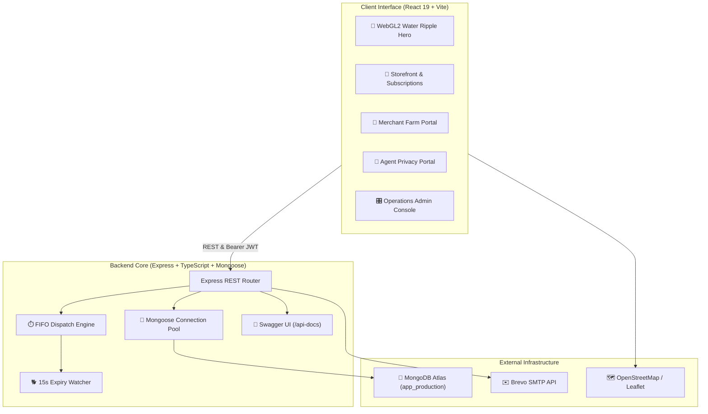
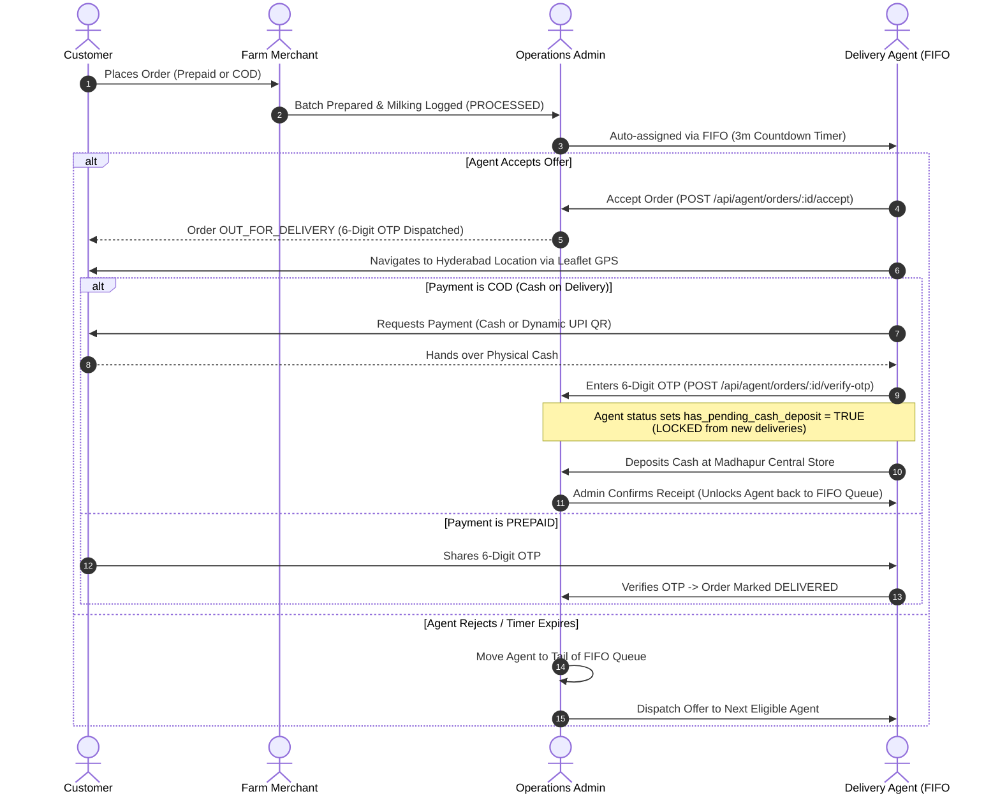

<div align="center">

```
  ____                 ____             _       
 |  _ \ _   _ _ __ ___|  _ \ ___  _   _| |_ ___ 
 | |_) | | | | '__/ _ \ |_) / _ \| | | | __/ _ \
 |  __/| |_| | | |  __/  _ < (_) | |_| | ||  __/
 |_|    \__,_|_|  \___|_| \_\___/ \__,_|\__\___|
       HYDERABAD LOCAL MILK & DAIRY NETWORK
```

# PureRoute / LocalMilkforYou
### Hyperlocal Farm-Direct Dairy Marketplace & Dispatch Infrastructure
**Hyderabad, Telangana, India (PINs: 500xxx • Currency: INR ₹ • Calling Code: +91 🇮🇳)**

[](https://www.typescriptlang.org/)
[](https://react.dev/)
[](https://tailwindcss.com/)
[](https://expressjs.com/)
[](https://www.mongodb.com/atlas)
[](https://www.khronos.org/webgl/)
[](https://pureroute.onrender.com/api-docs)
[](https://leafletjs.com/)
[](https://www.brevo.com/)

<p align="center">
  <strong>Bridging heritage Deccan milk farms directly to Hyderabad doorsteps through precision physics, real-time dispatch, and zero-compromise consumer privacy.</strong>
</p>

[Quick Start](#-quick-start--local-development) • [Architecture](#-system-architecture) • [Core Innovations](#-core-architectural-innovations) • [Portals](#-the-four-specialized-portals) • [Security & Privacy](#-security-spec--threat-mitigation) • [API Reference](#-interactive-openapi-30-swagger-api) • [Demo Credentials](#-seeded-hyderabad-demo-credentials)

---

</div>

## 📌 Executive Summary

**PureRoute (LocalMilkforYou)** is a production-grade, full-stack dairy marketplace built specifically for the geographical, logistical, and cultural landscape of **Hyderabad, Telangana**. 

Rather than treating milk as a generic commodity, PureRoute models dairy down to its physiological quality indicators (**Fat %**, **SNF %**, and **morning/evening milking timestamps**). The application brings together traditional Deccan pastoral farms and tech corridor urban hubs (Madhapur, Gachibowli, Jubilee Hills, Banjara Hills) via a custom **WebGL2 water-ripple physical simulation**, an **automated FIFO agent rotation queue**, **universal dual-party 6-digit OTP confirmation**, and a **tamper-proof Cash-on-Delivery (COD) deposit lockout protocol**.

---

## ✨ Core Architectural Innovations

```
                                      PURE ROUTE
                     ┌─────────────────────────────────────────┐
                     │       PHYSICAL WATER RIPPLE ENGINE      │
                     │  GLSL ES 3.00 • Ping-Pong Heightmaps    │
                     └────────────────────┬────────────────────┘
                                          │
                  ┌───────────────────────┴───────────────────────┐
                  ▼                                               ▼
     ┌────────────────────────┐                      ┌────────────────────────┐
     │   HYPERLOCAL DISPATCH  │                      │    SECURITY & COD      │
     ├────────────────────────┤                      ├────────────────────────┤
     │ • Strict +91 & 500xxx  │                      │ • Agent Item Masking   │
     │ • 60s Presence Monitor │                      │ • Universal 6-Digit OTP│
     │ • 2-5m FIFO Rotation   │                      │ • Anti-Theft Lockout   │
     │ • Leaflet Route Sync   │                      │ • Dynamic UPI QR Engine│
     └────────────────────────┘                      └────────────────────────┘
```

### 1. 🌊 Real-Time WebGL2 Physical Water Ripple Hero
* **GLSL ES 3.00 Wave Equation**: Displaces UV coordinates across two alternating $512 \times 512$ ping-pong framebuffers (`RGBA16F` with fallback to biased `RGBA8`).
* **Optical Physics**: Real-time normal mapping, Fresnel refraction, caustics, and specular highlights calculated directly on GPU fragments.
* **Integrated GPU Guard**: Clamps `devicePixelRatio` to `1.5` and includes an automatic thermal/FPS failsafe to guarantee smooth 60 FPS execution on budget and integrated GPUs.
* **Atmospheric Motion**: Incorporates dynamic pointer interaction (continuous 18px cursor wakes and 36px radial click splashes) paired with a subtle 16-second ambient breathing pulse.

### 2. 🛡️ Strict Privacy-Masked Delivery Architecture
* **Delivery Agent Isolation**: Delivery agents never see sensitive item details, culinary descriptions, or dairy product photography.
* **Zero PII Exposure**: Orders are presented to riders strictly as opaque item codes and count metrics (e.g., `Product ID: #102 × 2 Units`).
* **Cryptographic Invariant**: Customer dietary habits, high-ticket dairy preferences, and full basket metadata remain exclusively between the customer and the farm merchant.

### 3. ⏱️ Active FIFO Dispatch & Dynamic Rotation Engine
* **Presence Queue**: Delivery agents broadcast a 60-second heartbeat (`POST /api/agent/heartbeat`) maintaining real-time coordinates, battery readiness, and active status.
* **Fair Dispatch Lifecycle**: When an order transitions to `PROCESSED`, it is offered exclusively to the `#1` agent at the head of the FIFO queue with a strict 2 to 5 minute acceptance countdown.
* **Automated Rotation**: If an agent rejects or lets the countdown lapse, the background watcher immediately drops that agent to the tail of the queue and pushes the order to the next available rider without administrative friction.

### 4. 🔐 Universal 6-Digit Delivery OTP & Anti-Fraud Handshake
* **Mutual Protection**: Generated upon agent acceptance, a cryptographically random 6-digit OTP is synced in real time to the customer's portal and dispatched via Brevo transactional email.
* **Enforced Handoff**: Order status cannot transition to `DELIVERED` without live verification of this OTP by the delivery agent, protecting against false delivery claims for both Prepaid and Cash-on-Delivery orders.

### 5. 💰 Cash-on-Delivery (COD) Lockout & Dynamic UPI QR System
* **Dynamic UPI QR Codes**: For contactless door payments, on-the-spot exact-value UPI QR codes are rendered dynamically via `qrcode` with merchant VPAs.
* **Store-Deposit Anti-Theft Lockout**: If physical cash is collected at the door, the agent's account flag `has_pending_cash_deposit` is instantly tripped. This blocks the agent from receiving any new FIFO or manual orders until the cash is physically reconciled at the central Madhapur hub and released by Operations Admin.

---

## 🗺️ System Architecture

### Monolithic Micro-Kernel Architecture



---

## 🔄 Dispatch & Settlement Lifecycle



---

## 🚪 The Four Specialized Portals

| Portal | Intended User | Key Capabilities |
| :--- | :--- | :--- |
| **🛍️ Storefront & Customer** | Hyderabad Residents | • Browse morning/evening farm batches with live Fat/SNF %<br/>• Create recurring daily morning/evening milk subscriptions<br/>• Strict Hyderabad validation (`+91 [6-9]XXXXXXXXX`, `500xxx` PIN)<br/>• Live Leaflet telemetry with dynamic polyline route tracking<br/>• Synced 6-digit delivery OTP display & post-delivery rating prompts |
| **🚜 Local Dairy Merchant** | Deccan Farm Partners | • Publish daily batch metrics (Milking timestamp, Fat %, SNF %)<br/>• Track live stock availability and delivery batch status<br/>• Onboard farm credentials verified by central administration |
| **🛵 Delivery Agent Portal** | Field Delivery Fleet | • 2-Step Brevo email onboarding with temporary bcrypt passwords<br/>• **Strict Privacy Masking**: View orders by `#ID` and quantities only<br/>• Real-time FIFO acceptance countdowns (2–5 mins)<br/>• Live GPS location broadcaster & on-the-spot dynamic UPI QR codes<br/>• Cash-in-hand reconciliation and depot deposit workflow |
| **🎛️ Operations Admin** | Dispatch Management | • Real-time dispatch console with manual override capabilities<br/>• Live FIFO agent rotation queue inspector and activity monitor<br/>• Brevo Transactional Email outbox inspector and delivery audit logs<br/>• COD cash deposit verification & agent lockout release controls |

---

## 🥛 Hyderabad Farm-Direct Product Catalog

All dairy products are sourced from verified Deccan heritage farms, strictly cataloged with complete nutritional, chemical, and physical parameters:

| ID | Product Name | Fat % | SNF % | Volume / Pack | Base Price | Delivery Window |
| :---: | :--- | :---: | :---: | :---: | :---: | :---: |
| `#101` | **Heritage Murrah Buffalo Milk** | 7.5% | 9.2% | 1 Litre Glass Bottle | ₹85 | 05:30 AM – 07:30 AM |
| `#102` | **Pure Desi Gir Cow A2 Milk** | 4.2% | 8.8% | 1 Litre Glass Bottle | ₹95 | 05:30 AM – 07:30 AM |
| `#103` | **Organic Terracotta Set Curd (Dahi)** | 6.0% | 9.0% | 500g Earthen Pot | ₹60 | Morning / Evening |
| `#104` | **Hand-Pressed Malai Farm Paneer** | 22.0% | – | 250g Vacuum Block | ₹130 | Same-Day Fresh |
| `#105` | **Cultured Vedic A2 Bilona Ghee** | 99.7%| – | 500ml Heritage Jar | ₹850 | On Demand |
| `#106` | **Spiced Hyd Dairy Buttermilk (Chaas)**| 1.8% | 8.2% | 300ml Chilled Bottle | ₹30 | 11:00 AM – 04:00 PM |
| `#107` | **Buffalo Milk (Compact Single Serve)** | 7.5% | 9.2% | 500ml Pouch | ₹45 | Morning / Evening |

---

## 🍃 MongoDB Atlas Architecture (`app_production`)

PureRoute is backed by a native **MongoDB Atlas 8.0** cluster. All collections adhere to strict Mongoose schemas with explicit indexing, automatic timestamps, and clean JSON serialization (`_id` transformed to string `id`, `__v` stripped, `passwordHash` omitted from client returns).

```
app_production
├── users                 # Customers, verified merchants, active agents, admin with bcrypt hashes
├── products              # Seed dairy catalog (#101–#107) with Fat/SNF %, stock & freshness
├── orders                # Full order lifecycle, universal 6-digit OTPs & dynamic UPI QR codes
├── subscriptions         # Daily morning/evening recurring milk delivery schedules
├── reviews               # Verified customer ratings & comments for products
├── email_logs            # Brevo transactional email audit trail
└── feedback_preferences  # Persistent modal reminder preferences per customer
```

### Initializing & Viewing in MongoDB Compass
To initialize all schemas, build unique indexes, and seed sample data directly into your cluster:
```bash
npm run db:init
```
You can inspect the resulting database in **MongoDB Compass** by connecting to:
`mongodb+srv://cluster0.nbcjv7c.mongodb.net/app_production`

---

## 🔒 Security Spec & Threat Mitigation

PureRoute implements strict backend authorization, input boundary enforcement, and data isolation:

```
[Threat Vector]                          [PureRoute Defense Mechanism]
Identity Spoofing              ──►  JWT Bearer tokens validated against Mongoose user models
Privilege Escalation           ──►  Role creation locked to 'customer'; admin escalation blocked
Shadow Field Injection         ──►  Strict Mongoose schema validation & allowlisting
PII Blanket Scraping           ──►  Owner-isolated endpoints; agent masked product views
Client Timestamp Forgery       ──►  Server-generated timestamps (now.toISOString())
Payload Size Poisoning         ──►  Maximum string length bounded & validated
Telangana Geospatial Poisoning ──►  Regex boundaries: ^\+91[6-9]\d{9}$ & ^500\d{3}$
```

---

## 📖 Interactive OpenAPI 3.0 (Swagger) API

PureRoute features a fully documented REST backend complying with the OpenAPI 3.0 specification.

* **Interactive Swagger UI (Production)**: [https://pureroute.onrender.com/api-docs](https://pureroute.onrender.com/api-docs) (or proxied at [https://purelocalmilk.netlify.app/api-docs](https://purelocalmilk.netlify.app/api-docs))
* **Interactive Swagger UI (Local)**: [http://localhost:3000/api-docs](http://localhost:3000/api-docs)
* **Raw OpenAPI JSON**: [https://pureroute.onrender.com/api/openapi.json](https://pureroute.onrender.com/api/openapi.json)

### Core Endpoints Overview

```
AUTH & PROFILE
├── POST   /api/auth/register-customer    # Register customer account (+91 phone validation)
├── POST   /api/auth/login                # Standard JWT credential exchange
├── POST   /api/auth/agent-register       # Initiates Brevo 2-step email onboarding
├── POST   /api/auth/verify-agent-email   # Validates token & emails temporary bcrypt password
├── POST   /api/auth/agent-first-login    # Forces upgrade from temp to permanent password
├── POST   /api/upload/avatar             # Multipart avatar upload (max 2MB, base64 data URI)
└── GET    /api/profile/me                # Fetches active authenticated user profile

CATALOG & ORDERS
├── GET    /api/products                  # Lists active dairy catalog with Fat/SNF metrics
├── GET    /api/subscriptions             # Customer's active morning/evening recurring orders
├── POST   /api/subscriptions             # Creates new daily recurring milk delivery
├── POST   /api/orders/checkout           # Validates Hyderabad address & places order
└── GET    /api/orders/my-orders          # Order history with live Leaflet coordinates & OTP

DISPATCH & AGENT OPERATIONS
├── POST   /api/agent/heartbeat           # 60s presence heartbeat & live GPS ping
├── GET    /api/agent/orders              # Fetches assigned masked orders (Zero PII leakage)
├── POST   /api/agent/orders/:id/accept   # Accepts FIFO offer (Triggers 6-digit OTP generation)
├── POST   /api/agent/orders/:id/reject   # Rejects offer (Pushes agent to back of FIFO queue)
├── POST   /api/agent/orders/:id/verify-otp # Validates customer OTP for delivery completion
└── POST   /api/agent/orders/:id/mark-qr-paid # Initiates dynamic UPI QR verification flow

OPERATIONS ADMIN CONSOLE
├── GET    /api/admin/orders              # Master order book across Hyderabad
├── POST   /api/admin/orders/:id/status   # Manual order lifecycle overrides
├── GET    /api/admin/agents              # Real-time FIFO queue monitor and agent states
├── POST   /api/admin/orders/:id/clear-cash # Releases agent from Cash-on-Delivery lockout
└── GET    /api/admin/email-logs          # Live Brevo transactional email audit inspector
```

---

## 🔑 Seeded Hyderabad Demo Credentials

The development and demonstration store comes pre-seeded with realistic Hyderabad operational data:

| Persona | Email | Password | Pre-Configured State / Testing Scenario |
| :--- | :--- | :--- | :--- |
| **Customer** | `ananya@pureroute.in` | `PureMilk@2026` | Has 1 live `OUT_FOR_DELIVERY` order (Active OTP: `482916`), 1 `PROCESSING` order, and 1 completed order with review reminder prompt. |
| **Farm Merchant** | `srinivas.farm@pureroute.in` | `FarmFresh@2026` | Verified Deccan Meadows Dairy partner; manages live morning batch #101-#103. |
| **Delivery Agent #1** | `ravi.agent@pureroute.in` | `AgentHyd@2026` | Active FIFO Rank `#1` ready for incoming assignment. |
| **Delivery Agent #2** | `priya.agent@pureroute.in` | `AgentHyd@2026` | Active FIFO Rank `#2`; currently assigned live route `PR-HYD-1001`. |
| **Delivery Agent #3** | `alex.agent@pureroute.in` | `AgentHyd@2026` | Active FIFO Rank `#3`; non-binary profile with customized avatar. |
| **Operations Admin** | `admin@pureroute.in` | `AdminHyd@2026` | Full dispatch console, Brevo email audit trail, and COD cash lockout management. |

---

## 📁 Repository Anatomy

```
pureroute-localmilkforyou-hyderabad/
├── scripts/
│   └── init-db.ts             # MongoDB Atlas schema initialization & seeding script
├── server/
│   ├── database.ts            # Mongoose singleton connection manager & healthcheck
│   ├── models/
│   │   └── index.ts           # Mongoose schemas (users, products, orders, subscriptions, reviews, logs)
│   ├── brevo.ts               # Brevo transactional email HTTPS dispatcher
│   ├── openapi.ts             # Complete OpenAPI 3.0 specification dictionary
│   └── store.ts               # Unified data store syncing with MongoDB Atlas
├── src/
│   ├── assets/images/         # Ultra high-res morning dew & dairy product visuals
│   ├── components/
│   │   ├── AdminConsole.tsx   # Master dispatch, FIFO queue monitor & email inspector
│   │   ├── AuthAndProfileModal.tsx # Multi-role login, register & avatar customizer
│   │   ├── DeliveryAgentPortal.tsx # Masked order view, accept countdown & OTP pad
│   │   ├── FeedbackReminderModal.tsx # Timed post-delivery rating prompt
│   │   ├── LiveHyderabadMap.tsx # Leaflet GPS routing & animated agent telemetry
│   │   ├── MerchantPortal.tsx # Batch publishing & Fat/SNF specification manager
│   │   ├── StorefrontAndCustomerPortal.tsx # Catalog, subscription manager & checkout
│   │   └── WaterRippleHero.tsx # GLSL ES 3.00 WebGL2 ping-pong ripple simulation
│   ├── lib/
│   │   ├── api.ts             # Typed REST client with automatic JWT token attachment
│   │   └── avatars.ts         # Diverse avatar resolver supporting custom uploads
│   ├── types/
│   │   └── domain.ts          # Core domain models, enums & Hyderabad constants
│   ├── App.tsx                # View router, global navigation & role guard gates
│   └── index.css              # Tailwind CSS v4 styling & typography rules
├── .env.example               # Template for environment configuration
├── server.ts                  # Express server, Vite middleware & REST endpoints
└── vite.config.ts             # Vite configuration with Tailwind CSS v4 plugin
```

---

## 🚀 Quick Start & Local Development

### Prerequisites
* **Node.js**: v18.0.0 or higher
* **npm** or **bun** package manager

### 1. Clone & Install Dependencies
```bash
git clone https://github.com/your-org/pureroute-localmilkforyou-hyderabad.git
cd pureroute-localmilkforyou-hyderabad
npm install
```

### 2. Configure Environment Variables
Create a `.env` file in the root directory (or copy from `.env.example`):
```bash
cp .env.example .env
```

```ini
# MongoDB Atlas 8.0 Connection URI & Database
MONGODB_URI="mongodb+srv://<username>:<password>@cluster0.xxxxxxx.mongodb.net/app_production?retryWrites=true&w=majority&appName=Cluster0"
DB_NAME="app_production"

# Application URL for verification links
APP_URL="http://localhost:3000"

# Secret key for JWT Bearer tokens
JWT_SECRET="pureroute-hyderabad-secure-jwt-key-2026"

# Brevo Transactional Email API (Optional - logs to Admin Console if omitted)
BREVO_API_KEY=""
BREVO_SENDER_EMAIL="dispatch@pureroute.in"
BREVO_SENDER_NAME="PureRoute Hyderabad"

# Dynamic UPI QR Code Merchant VPA
UPI_MERCHANT_VPA="pureroute.hyd@icici"
UPI_MERCHANT_NAME="PureRoute Dairy Hyderabad"

# FIFO Offer Expiry Window (2 to 5 minutes)
FIFO_OFFER_MINUTES="3"
```

### 3. Launch Development Server
```bash
npm run dev
```

Visit the application in your browser:
* 🌐 **Application Portal**: [http://localhost:3000](http://localhost:3000)
* 📖 **OpenAPI 3.0 Swagger UI**: [https://pureroute.onrender.com/api-docs](https://pureroute.onrender.com/api-docs) (or local: [http://localhost:3000/api-docs](http://localhost:3000/api-docs))

---

## 🛠️ Verification & Quality Checks

Run TypeScript compiler validation to verify type integrity:
```bash
npm run lint
```

Build production distribution:
```bash
npm run build
```

---

<div align="center">
  <sub>Crafted with pride in Hyderabad, Telangana 🇮🇳 • PureRoute Engineering</sub>
</div>
